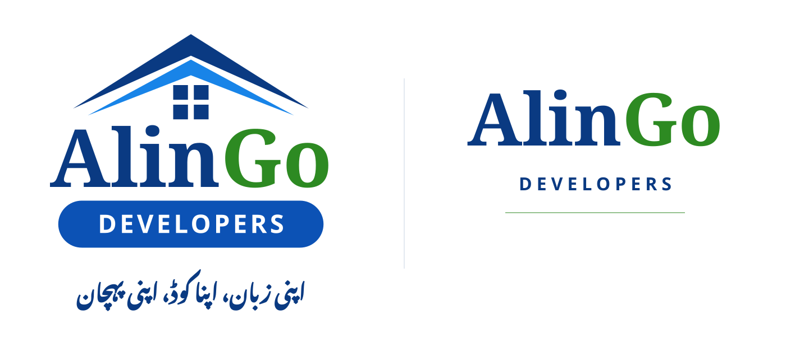

<h1>SUPL — سُپل پروگرامنگ زبان</h1>

<strong>6 زبانیں، ایک پروگرامنگ زبان</strong>

<em>Saraiki · Urdu · Punjabi · Balochi · Pashto · Sindhi</em>

---

## 🌍 SUPL کیا ہے؟

**SUPL** دنیا کی **پہلی 6 زبانی پروگرامنگ زبان** ہے جو ایک ہی فائل میں **سرائیکی، اردو، پنجابی، بلوچی، پشتو اور سندھی** — چھ زبانوں کو سپورٹ کرتی ہے۔

> **جیہڑا لفظ سمجھ آوے، اوہو ورتو**

آپ کوئی بھی زبان کا لفظ استعمال کریں — پروگرام چلے گا۔

| زبان | متغیر | اگر | فنکشن | پرنٹ |
|------|--------|-----|--------|------|
| 🟢 **سرائیکی** | `شے` | `جے` | `کم` | `لکھو` |
| 🔵 **اردو** | `متغیر` | `اگر` | `فنکشن` | `لکھو` |
| 🟡 **پنجابی** | `شے` | `جے` | `کم` | `لکھو` |
| 🟠 **بلوچی** | `چیز` | `گَر` | `کار` | `بنڈ` |
| 🟣 **پشتو** | `توکی` | `که` | `کار` | `ولیكه` |
| 🔴 **سندھی** | `شئي` | `جيڪڏهن` | `ڪم` | `لکو` |

---

## ✨ خصوصیات

- ✅ **6 زبانیں** — ایک ساتھ، ایک فائل میں
- ✅ **218 keywords** — تمام 6 زبانوں میں
- ✅ **مکمل OOP** — کلاسز، کنسٹرکٹر، methods، properties، وراثت
- ✅ **Exception Handling** — `کوشش` / `پکڑو` / `آخر_میں`
- ✅ **Loop Control** — `روک_ڈیو` (BREAK), `اگوں_ٹرو` (CONTINUE)
- ✅ **Switch/Case** — `منتخب` / `صورت` / `ڈیفالٹ`
- ✅ **Chain Calls** — `یہ.اشیاء.شامل_کریں(آئٹم)`
- ✅ **Index Access** — `یہ.اشیاء[i].دکھاؤ()`
- ✅ **stdlib** — `فائلاں`، `ویب`، `ڈیٹا`، `ویلہ`، `ڳنتری`
- ✅ **اپنا پیکیج مینیجر** — `سرائیکی` (pip کا متبادل)
- ✅ **4 CLI کمانڈز** — `saraiki`, `supl`, `urdu`, `سرائیکی`

---

## 📥 تنصیب

pip کے ذریعے:

    pip install supl-lang

سورس سے:

    git clone https://github.com/alingosuper/SUPL.git
    cd SUPL
    pip install -e .

اختیاری خصوصیات:

    pip install supl-lang[web]      # ویب کے ساتھ
    pip install supl-lang[ml]       # ML کے ساتھ
    pip install supl-lang[full]     # سب کچھ

تصدیق:

    saraiki --version

---

## 🚀 پہلا پروگرام

hello.slk فائل:

    پندھ_شروع "میرا پہلا پروگرام"
        لکھو("السلام علیکم دنیا!")
    پندھ_مک_گیا

چلائیں:

    saraiki hello.slk

نتیجہ:

    میرا پہلا پروگرام
    السلام علیکم دنیا!

---

## 🎨 6 زبانیں — ایک ساتھ

    پندھ_شروع "6 زبانیں"

    # اردو
    متغیر نام = "علی"
    اگر نام برابر "علی" {
        لکھو("اردو ✅")
    }

    # سرائیکی
    شے عمر = 25
    جے عمر وڈا 18 {
        لکھو("سرائیکی ✅")
    }

    # بلوچی
    چیز شہر = "کوئٹہ"
    گَر شہر برابر "کوئٹہ" {
        بنڈ("بلوچی ✅")
    }

    # پشتو
    توکی نوم = "احمد"
    که نوم برابر "احمد" {
        ولیكه("پشتو ✅")
    }

    # سندھی
    شئي نالو = "کراچی"
    جيڪڏهن نالو برابر "کراچی" {
        لکو("سندھی ✅")
    }

    پندھ_مک_گیا

---

## 📚 کلیدی الفاظ — مثالیں

شرائط:

    اگر عمر وڈا 18 {
        لکھو("بالغ")
    } ورنہ {
        لکھو("نابالغ")
    }

لوپس:

    شے x = 0
    جدوں_تئیں x نکا 5 {
        لکھو(x)
        x = x جمع 1
    }

    برائے i میں 0 تک 5 {
        لکھو(i)
    }

BREAK + CONTINUE:

    جدوں_تئیں سچ {
        اگر x برابر 5 {
            روک_ڈیو
        }
        x = x جمع 1
    }

    برائے i میں 0 تک 10 {
        اگر i برابر 3 {
            اگے_ٹرو
        }
        لکھو(i)
    }

Switch/Case:

    منتخب x {
        صورت 1 { لکھو("ایک") }
        صورت 2 { لکھو("دو") }
        ڈیفالٹ { لکھو("اور") }
    }

فنکشنز:

    کم جمع(الف، ب) {
        واپس_ڈیو الف جمع ب
    }
    لکھو(جمع(5, 3))

کلاسز (OOP):

    کلاس شخص {
        تعمیر(نام، عمر) {
            یہ.نام = نام
            یہ.عمر = عمر
        }
        فنکشن دکھاؤ() {
            لکھو(یہ.نام, یہ.عمر)
        }
    }
    شے علی = نیا شخص("علی", 25)
    علی.دکھاؤ()

Try/Catch/Finally:

    کوشش {
        شے نتیجہ = 10 ونڈ 0
    } پکڑو(غلطی) {
        لکھو("خرابی:", غلطی)
    } آخر_میں {
        لکھو("ہمیشہ چلے گا")
    }

---

## 📦 معیاری لائبریری

فائلاں (فائل I/O):

    شامل_کرو "فائلاں"
    فائلاں.لکھو("data.txt", "السلام علیکم")
    شے مواد = فائلاں.پڑھو("data.txt")
    لکھو(مواد)

ڳنتری (ریاضی):

    شامل_کرو "ڳنتری"
    لکھو(ڳنتری.پائی)
    لکھو(ڳنتری.جذر(16))
    لکھو(ڳنتری.طاقت(2, 10))

ویلہ (تاریخ/وقت):

    شامل_کرو "ویلہ"
    لکھو(ویلہ.اب())
    لکھو(ویلہ.آج())
    لکھو(ویلہ.سال())

ڈیٹا (JSON/CSV):

    شامل_کرو "ڈیٹا"
    شے ڈیٹا = {"نام": "علی"}
    شے json = ڈیٹا.json_میں(ڈیٹا)
    لکھو(json)

ویب (HTTP):

    شامل_کرو "ویب"
    شے جواب = ویب.حاصل_کرو("https://api.github.com")
    لکھو(جواب)

---

## 🔧 CLI کمانڈز

پروگرام چلانا:

    saraiki program.slk
    supl program.slk
    urdu program.slk

پیکیج مینیجر:

    سرائیکی نصب requests
    سرائیکی ہٹاؤ requests
    سرائیکی فہرست
    سرائیکی ڈکھاؤ pip
    سرائیکی اپگریڈ pip
    سرائیکی مدد

REPL:

    saraiki -i

---

## 📁 پروجیکٹ ڈھانچہ

    SUPL/
    ├── lexer/              # Lexer + 218 keywords
    ├── parser/             # Parser
    ├── interpreter.py      # Interpreter
    ├── stdlib/             # 5 ماڈیولز
    ├── supl/               # CLI + package manager
    ├── docs/               # 116 دستاویزات
    ├── examples/           # مثالیں
    ├── tests/              # Golden tests
    ├── my_todo_app/        # مکمل OOP مثال
    └── setup.py            # supl-lang v2.0.0

---

## 📖 دستاویزات

- شروعات — 5 منٹ میں پہلا پروگرام
- کلیدی الفاظ — 218 keywords
- نحو — مکمل syntax
- stdlib — 5 ماڈیولز
- مثالیں — نمونہ پروگرام

---

## 🧪 اختبار

    python3 -m pytest tests/ -q
    cd my_todo_app && saraiki main.slk

---

## 👨‍💻 تخلیق کار

**AlinGo Developers (النگو ڈویلپرز)**

- GitHub: [@alingosuper](https://github.com/alingosuper)
- Repository: [SUPL](https://github.com/alingosuper/SUPL)

---

## 📄 لائسنس

MIT License — آزاد استعمال، ترمیم اور تقسیم کی اجازت ہے۔

---

**🌟 اگر یہ پروجیکٹ پسند آیا تو ⭐ دیں 🌟**

**6 زبانیں · 218 keywords · ایک پروگرامنگ زبان**

